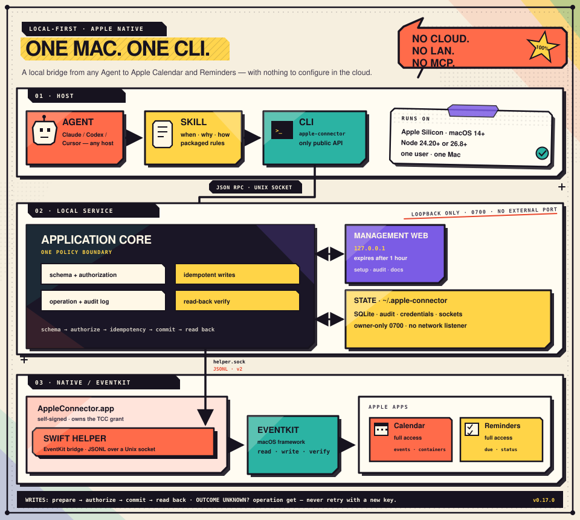

# Apple Connector

**A local bridge from any Agent to Apple Calendar and Reminders.** One CLI, one local service, one native helper — with no cloud, LAN, or MCP endpoint.



> **Distribution status:** npm and local source builds only. There is no standalone `.app` download, DMG, Homebrew Cask, or notarized build yet. See the [distribution decision](docs/distribution-decision.md).

## At a glance

| Topic | Detail |
| --- | --- |
| **Runs on** | Apple Silicon Mac, macOS 14+, a supported Node version |
| **Public entry point** | `apple-connector` CLI; the packaged [Skill](skill/SKILL.md) teaches an Agent when and how to call it |
| **Local state** | `~/.apple-connector` — SQLite, authorizations, audit, logs, and Unix sockets |
| **Permission owner** | Self-signed `AppleConnector.app` (bundle ID `com.jachy.apple-connector`) |
| **Management page** | Loopback only; expires after one hour |
| **Network surface** | No LAN, cloud, or MCP endpoint |

Since v0.17.0 the EventKit helper runs inside the self-signed `AppleConnector.app`. macOS records Calendar/Reminders permission for **Apple Connector**, not for Terminal or your Agent host, and the grant survives upgrades that keep the signing identity. See [system permissions](docs/system-permissions.md) and [signing](docs/signing.md).

Upgrading from a build that used `~/apple-connector`? Run `apple-connector migrate-state` once.

## Architecture

The diagram above shows three tiers:

- **Host** — Your Agent loads the packaged Skill, which carries the rules for choosing Calendar vs Reminders and for calling the CLI. The CLI is the only public business interface; an Agent never calls the helper, database, or Web API directly.
- **Local service** — The CLI talks to a Node service over a Unix socket. Its Application Core validates each request, checks the authorization scope, enforces idempotency, records the operation and audit events, and reads back the result. SQLite and credentials live in `~/.apple-connector`. The management page is a separate loopback process that expires after one hour.
- **Native** — The core calls a Swift EventKit helper over `helper.sock`. The helper runs inside `AppleConnector.app`, so it owns the macOS permission. It reaches EventKit, then Apple Calendar and Reminders.

Every write follows `prepare → authorize → commit → read back`. A write inside the granted scope executes immediately; there is no approval queue. If the result is unknown (timeout or interrupted connection), query `operation get` with the original operation ID — never retry with a new idempotency key.

## For people: connect in four steps

### 1. Install the CLI

Published package:

```bash
npm install -g @jachy/apple-connector
apple-connector version
```

From source:

```bash
npm run signing:check   # fails if the self-signed identity is missing
npm ci && npm run build
npm link
apple-connector version
```

If `signing:check` reports the identity is missing, create it once in Keychain Access. See [signing](docs/signing.md) for the exact steps. `npm run build` produces the management UI, the Node service, and the signed helper App.

### 2. Initialise local state

```bash
apple-connector init
```

This initialises `~/.apple-connector`, starts or reuses the service, and opens the loopback management page. The page expires after one hour; running `init` again later behaves like `open`.

### 3. Authorise on the setup page

1. **Grant macOS access.** The prompt names **Apple Connector**; choose full access. The authorization step stays locked without it.
2. **Create one authorization for one Agent.** Choose the Calendar and Reminders containers, actions, and expiry (one year by default).
3. **Copy the Agent prompt.** New authorizations offer two versions; see below.

### 4. Verify from the Agent

Paste the prompt into the Agent. After it runs `apple-connector auth verify --agent <name>` and one read-only query, step 4 of the page shows **Agent bound** with the verification time.

### Which prompt should I paste?

| Prompt | Contains | Use it when |
| --- | --- | --- |
| **Recommended** | Authorization key — a local profile identifier, not a bearer secret | Default. The CLI resolves the owner-only credential on this Mac itself. |
| **Fallback** | Authorization ID — a bearer token | The key cannot be used. The ID will remain in the chat history. |

Existing authorizations show the recommended prompt only, because the authorization ID is returned once at creation and is also written to an owner-only local credential file. An authorization is immutable: delete and recreate it to change scope. Use `apple-connector open` later for setup, audit, or docs. If the page has expired, run `apple-connector init` again.

Upgrading from v0.16.x or earlier changes the permission owner to Apple Connector, so grant Calendar and Reminders once more on the setup page. The old Terminal/OpenCode entries are no longer used.

## For Agents

Apple Connector is host-neutral. An Agent runs locally on the same Apple Silicon Mac, executes the CLI, and reads the packaged [Skill](skill/SKILL.md).

### Connect

1. Load the Skill: `apple-connector skill path --json`.
2. Bind the authorization:

   ```bash
   apple-connector auth verify --agent '<your name>' --auth-key '<key>' --json
   ```

   Pass the authorization key with `--auth-key`; let the CLI resolve the credential. Never read, copy, scan, or print token files in the profile directory.
3. Verify with one bounded read-only query: `calendar list-calendars` or `reminder list-lists`.

If the prompt contains an authorization ID instead of a key, store it in the host's secret store or an owner-only `0600` file, pass it through `APPLE_CONNECTOR_AUTH` or `--auth-file`, and never echo it. An older prompt may contain an explicit `Credential file` path; pass it with `--auth-file` without reading or printing it. Use `apple-connector auth show --auth-key '<key>' --json` to inspect the name, scope, or expiry.

If the prompt is missing or expired, ask the user to run `apple-connector init` again. Do not scan the state or profile directory for tokens, and do not call business commands before authorization is verified.

### Machine contract

Every machine-facing command accepts `--json` and returns one versioned envelope. Writes require an authorization key or ID and a stable `--idempotency-key`; in-scope writes execute immediately.

## Documentation

| Guide | English | 中文 |
| --- | --- | --- |
| Documentation index | [docs/README.md](docs/README.md) | [docs/README_zh.md](docs/README_zh.md) |
| Getting started | [docs/getting-started.md](docs/getting-started.md) | [docs/getting-started_zh.md](docs/getting-started_zh.md) |
| CLI reference | [docs/cli.md](docs/cli.md) | [docs/cli_zh.md](docs/cli_zh.md) |
| Agent installation | [docs/install-for-agent.md](docs/install-for-agent.md) | [docs/install-for-agent_zh.md](docs/install-for-agent_zh.md) |
| Skill reference | [docs/skill.md](docs/skill.md) | [docs/skill_zh.md](docs/skill_zh.md) |
| System permissions | [docs/system-permissions.md](docs/system-permissions.md) | [docs/system-permissions_zh.md](docs/system-permissions_zh.md) |
| Signing without an Apple Developer account | [docs/signing.md](docs/signing.md) | [docs/signing_zh.md](docs/signing_zh.md) |
| Upgrade guide | [docs/v0.8-to-v0.9-migration.md](docs/v0.8-to-v0.9-migration.md) | — |

Current release: **0.17.0** · [Full version history](docs/README.md#version-history)
