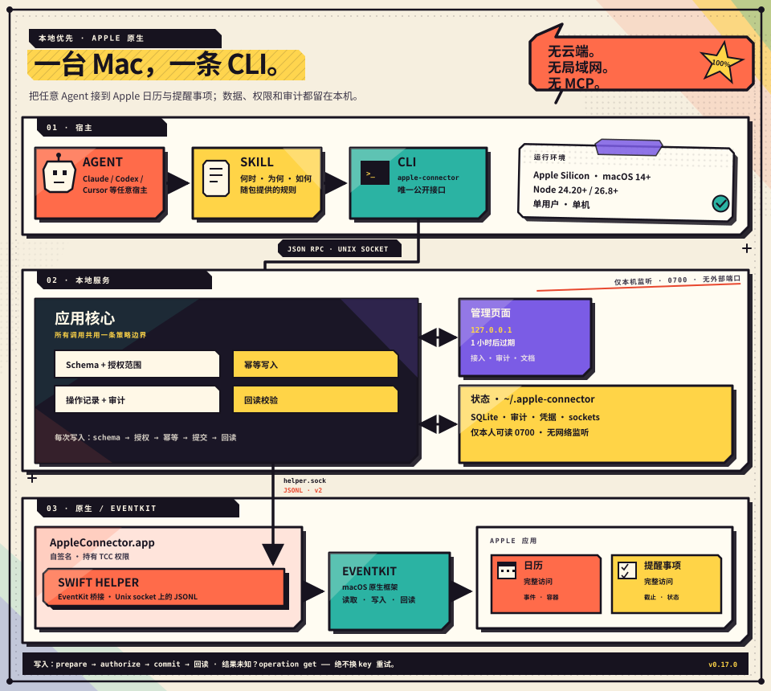

# Apple Connector

**把任意 Agent 接到 Apple 日历与提醒事项的本地桥梁。** 一条 CLI、一个本地服务、一个原生 helper；没有云端、局域网或 MCP 入口。



> **分发状态：** 目前仅支持 npm 和本机源码构建。暂不提供独立 `.app` 下载、DMG、Homebrew Cask 或公证构建。详见[分发决策](docs/distribution-decision.md)。

## 一眼看清

| 项目 | 说明 |
| --- | --- |
| **运行环境** | Apple Silicon Mac、macOS 14+、受支持的 Node 版本 |
| **公开入口** | `apple-connector` CLI；随包 [Skill](skill/SKILL.md) 指导 Agent 何时、如何调用 |
| **本地状态** | `~/.apple-connector` — SQLite、授权、审计、日志和 Unix socket |
| **权限归属** | 自签名 `AppleConnector.app`（bundle ID `com.jachy.apple-connector`） |
| **管理页面** | 仅监听本机 loopback，一小时后过期 |
| **网络暴露** | 无局域网、云端或 MCP 入口 |

从 v0.17.0 起，EventKit helper 运行在自签名 `AppleConnector.app` 中。macOS 把日历/提醒事项权限记在 **Apple Connector** 名下，而不是 Terminal 或 Agent 宿主；只要签名身份不变，升级后授权会保留。详见[系统权限](docs/system-permissions_zh.md)和[签名](docs/signing_zh.md)。

从使用 `~/apple-connector` 的旧版本升级？请执行一次 `apple-connector migrate-state`。

## 架构

上图包含三层：

- **宿主层** — Agent 加载随包 Skill，由它决定什么时候选日历、什么时候选提醒事项，以及如何调用 CLI。CLI 是唯一公开的业务接口；Agent 不会直接访问 helper、数据库或 Web API。
- **本地服务层** — CLI 通过 Unix socket 连接 Node 服务。应用核心负责校验请求、检查授权范围、执行幂等、记录操作与审计，并回读结果。SQLite 与凭据存放在 `~/.apple-connector`。管理页面是独立的 loopback 进程，一小时后过期。
- **原生层** — 应用核心通过 `helper.sock` 调用 Swift EventKit helper。helper 运行在 `AppleConnector.app` 内，因此由它持有 macOS 权限；它访问 EventKit，再访问 Apple 日历和提醒事项。

每次写入都遵循 `prepare → authorize → commit → 回读`。授权范围内的写入立即执行，没有审批队列。如果结果未知（超时或连接中断），用原操作 ID 查询 `operation get`，绝不换新的幂等 key 重试。

## 面向人类：四步接入

### 1. 安装 CLI

已发布包：

```bash
npm install -g @jachy/apple-connector
apple-connector version
```

从源码构建：

```bash
npm run signing:check   # 缺少自签名身份时会失败
npm ci && npm run build
npm link
apple-connector version
```

如果 `signing:check` 报告缺少签名身份，请先在 Keychain Access 中创建一次，具体步骤见[签名说明](docs/signing_zh.md)。`npm run build` 会构建管理页、Node 服务和已签名的 helper App。

### 2. 初始化本地状态

```bash
apple-connector init
```

它会初始化 `~/.apple-connector`、启动或复用服务，并打开本机 loopback 管理页。页面一小时后过期；后续再次运行等同于 `open`。

### 3. 在接入页完成授权

1. **授予 macOS 权限。** 弹窗名称是 **Apple Connector**，请选择完整访问；未授权时第 2 步保持锁定。
2. **为单个 Agent 创建一份授权。** 选择日历和提醒事项容器、动作与有效期（默认一年）。
3. **复制 Agent 提示词。** 新建授权会提供两个版本，见下文。

### 4. 让 Agent 完成验证

把提示词粘贴给 Agent。Agent 运行 `apple-connector auth verify --agent <名称>` 并完成一次只读查询后，接入页第 4 步会显示 **Agent 已绑定**，并带上验证时间。

### 应该粘贴哪一版提示词？

| 提示词 | 包含 | 适用场景 |
| --- | --- | --- |
| **推荐版** | 授权 key — 本机 profile 标识，不是 bearer 秘密 | 默认。由本机 CLI 解析 owner-only 凭据。 |
| **备用版** | 授权码 — bearer token | 无法使用授权 key 时。授权码会留在聊天记录中。 |

已有授权只显示推荐版提示词，因为授权码只在创建时返回一次，并同时写入 owner-only 本地凭据文件。授权创建后不可编辑；需要变更时删除并重新创建。后续用 `apple-connector open` 打开接入、审计或使用文档页面。页面过期后重新运行 `apple-connector init`。

从 v0.16.x 或更早版本升级后，权限归属变为 Apple Connector，需要在接入页重新授权日历/提醒事项一次。旧的 Terminal/OpenCode 权限条目不再使用。

## 面向 Agent

Apple Connector 不绑定宿主。Agent 运行在同一台 Apple Silicon Mac 上，执行 CLI，并读取随包 [Skill](skill/SKILL.md)。

### 接入

1. 加载 Skill：`apple-connector skill path --json`。
2. 绑定授权：

   ```bash
   apple-connector auth verify --agent '<你的名称>' --auth-key '<key>' --json
   ```

   用 `--auth-key` 传入授权 key，由 CLI 自行解析凭据。不要读取、复制、扫描或打印 profile 目录中的 token 文件。
3. 用一次有界只读查询验证：`calendar list-calendars` 或 `reminder list-lists`。

如果提示词包含的是授权码而不是授权 key，请立即存入宿主 secret store 或权限 `0600` 的 owner-only 文件，通过 `APPLE_CONNECTOR_AUTH` 或 `--auth-file` 传入，不要回显。旧提示词可能包含显式 `Credential file` / `凭据文件` 路径；用 `--auth-file` 传入，但不要读取或打印。需要查看授权名称、范围或过期时间时，运行 `apple-connector auth show --auth-key '<key>' --json`。

如果提示词缺失或已过期，请让用户重新运行 `apple-connector init`。不要在授权验证前扫描状态目录或 profile 目录寻找 token，也不要调用业务命令。

### 机器接口约定

所有机器接口使用 `--json`，返回统一的版本化信封。写入必须提供授权 key 或授权码，以及稳定的 `--idempotency-key`；授权范围内的写入立即执行。

## 文档

| 指南 | 中文 | English |
| --- | --- | --- |
| 文档索引 | [docs/README_zh.md](docs/README_zh.md) | [docs/README.md](docs/README.md) |
| 快速开始 | [docs/getting-started_zh.md](docs/getting-started_zh.md) | [docs/getting-started.md](docs/getting-started.md) |
| CLI 参考 | [docs/cli_zh.md](docs/cli_zh.md) | [docs/cli.md](docs/cli.md) |
| Agent 安装说明 | [docs/install-for-agent_zh.md](docs/install-for-agent_zh.md) | [docs/install-for-agent.md](docs/install-for-agent.md) |
| Skill 参考 | [docs/skill_zh.md](docs/skill_zh.md) | [docs/skill.md](docs/skill.md) |
| 系统权限 | [docs/system-permissions_zh.md](docs/system-permissions_zh.md) | [docs/system-permissions.md](docs/system-permissions.md) |
| 不购买 Apple Developer 时的签名 | [docs/signing_zh.md](docs/signing_zh.md) | [docs/signing.md](docs/signing.md) |
| 升级指南 | — | [docs/v0.8-to-v0.9-migration.md](docs/v0.8-to-v0.9-migration.md) |

当前版本：**0.17.0** · [完整版本历史](docs/README_zh.md#版本历史)
